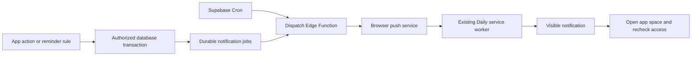

# Supabase, app sharing and push notification plan

Status: proposal only, 2026-10-18. This document authorizes no implementation, account creation, dependency installation, database migration, invitation, deployment or push delivery. Current runtime behavior remains local-only.

## Problem

Add optional Supabase persistence and cross-device access to all seven Daily apps. Share Coffee with one group and Games with another, with independent permissions for each app. Add scheduled Web Push delivered by Supabase Edge Functions, including when Daily is closed.

The existing [consolidation plan](pwa-consolidation-plan.md) remains authoritative for the shipped local architecture and migration gates. This is the focused proposal for a future extension of its no-account/no-backend scope. Implementing it requires the user to resume implementation; remote setup and delivery remain separately deferred under [working rules](../AGENTS.md).

### Current boundaries to preserve

- `packages/data/src/daily-state.js` and `module-store.js` persist one validated `daily:v1` root. Uploading that root would expose unrelated apps; it must never be a shared database row.
- Games, Time Budget and Piano commit domain state and timestamp activities together. Keep those transitions atomic and preserve explicit pause/finish semantics.
- The current local store supports one editing tab at a time. Its revision guards do not provide multi-device concurrency control.
- Reader tokens and disposable authenticated caches are outside backups. Piano score blobs live separately in IndexedDB and are absent from JSON backups.
- One generated service worker owns offline assets and updates. Coffee's current `notifications.js` displays in-app toasts; it is unrelated to system push.
- Preserve plain HTML/CSS/JavaScript modules, module appearance, EN/ES, dashboard navigation without domain writes, backup recovery and all existing source assertions.

## How It Works

### 1. One account, independent app spaces

Use Supabase Auth for identity and one Supabase Postgres database for storage. The authorization unit is an **app space**, a dataset belonging to exactly one app. Each space has its own owner and membership list. One account can own or join several spaces, including several for the same app.

Example:

| Space | App | Members | Other access granted |
| --- | --- | --- | --- |
| My Coffee | Coffee | You, Alice, Bob | None |
| Friday Games | Games | You, Carol | None |
| My Plants | Plants | You | None |

Alice can use the shared Coffee dataset without seeing Friday Games or your private Plants. Carol's Games membership grants no Coffee access. Joining a space never enrolls someone in another app. A private space simply has one member; it can later be shared after a content preview.

The UI keeps local-only use available without an account. Each app gets a visible space selector, cloud status, and **Sharing** settings. Shared and personal datasets remain separate; selecting a space never uploads or combines the user's local data automatically. Dashboard widgets summarize the selected space for each app and label it; they do not aggregate every joined dataset implicitly.

Proposed roles:

| Capability | Owner | Editor | Viewer |
| --- | --- | --- | --- |
| Read the selected space and download its permitted export | Yes | Yes | Yes |
| Add, edit, archive or delete app records through normal workflows | Yes | Yes | No |
| Run shared game/budget/practice transitions | Yes | Yes | No |
| Replace the entire space through import/restore | Yes | No | No |
| Invite, change roles or remove members | Yes | No | No |
| Transfer ownership or delete the space | Yes | No | No |
| Set personal notification preferences or leave membership | Yes | Yes | Yes |

Owners must transfer ownership or delete the space before leaving or deleting their account. Ownership transfer and its membership changes are one transaction. Default invitations grant Viewer; an owner can explicitly choose Editor. Members may leave without deleting shared records. Creation attribution remains after a member leaves, with account deletion anonymization defined in the retention policy.

### 2. Data model and database access

Start with one versioned JSONB domain document per app space, rather than immediately normalizing seven different domain models. This matches the existing validators, small observed datasets and atomic app workflows. All changes to a given space compare a server revision; a stale write fails and preserves both versions. Normalize individual records later only if measured contention or payload size warrants it.

| Proposed relation | Purpose and key constraints |
| --- | --- |
| `app_spaces` | UUID, allowlisted immutable `app_id`, label, owner, lifecycle status and server timestamps. |
| `app_memberships` | Unique `(space_id, user_id)` with owner/editor/viewer role; membership is authoritative on every request. |
| `app_documents` | One row per space: schema version, domain payload, that app's activities, integer revision and updater. App identity derives from the space. |
| `user_app_state` | User-private app settings per space, selections and opt-in sync preferences. Shared settings are explicitly classified separately. |
| `user_preferences` | User-private language and dashboard preferences; browser-specific installation details stay local. |
| `app_invitations` | Space, intended verified email, role, inviter, hashed random token, expiry, consumed/revoked status. Never client-readable as a list of tokens or emails. |
| `mutation_receipts` | Space, actor, mutation UUID and committed revision, unique per logical mutation, for safe retries. |
| `app_audit_events` | Bounded security/change metadata; no full document, token, push endpoint or sensitive content in logs. |
| `push_subscriptions` | Account and installation, endpoint, encryption keys, expiry and enabled status. Read/write is owner-private. |
| `notification_preferences` | Account, space/app, enabled event types, timezone, quiet hours and device choices. Membership required. |
| `reminder_rules` / `notification_jobs` | Validated schedules and recipient-specific queued occurrences, with unique occurrence keys, due time, expiry, attempts and lease. |
| `notification_deliveries` | Per-job/per-subscription attempt state and provider response category, with bounded retention. |

No `daily:v1` root, credential, unrelated activity, or personal dashboard layout belongs in `app_documents`. Independent countdowns belong to the selected Time Budget space. The existing global activities module becomes a local presentation assembled from selected spaces, with `(space_id, activity_id)` identity. Enforce the existing single unfinished game/budget/practice rule within each relevant space; never accidentally collapse IDs across spaces.

**Database enforcement:** enable RLS and explicit minimal grants on every exposed relation. Signed-out users have no app-data access. SELECT requires current membership; document writes require Editor or Owner. Use both old-row and new-row checks to prevent changing space identity. Revoke direct document DML and expose a controlled commit operation for revisions, receipts, activity validation and reminder changes. RLS and database grants work together; service-role credentials bypass RLS and must remain server-side. See [Supabase RLS](https://supabase.com/docs/guides/database/postgres/row-level-security).

The commit operation locks the space/document, checks current membership and expected revision, validates its allowed shape and references, applies the document/activity transition, advances the revision and records its receipt in one transaction. Mutation UUID retries return the prior result only after rechecking current access. All write paths must use the same lock ordering so revocation and commits serialize predictably. Client clocks never decide write order.

If full domain validation runs in an Edge Function using reusable pure JavaScript validators, the database write operation must be callable only by that trusted path; browsers must not bypass it with arbitrary JSON. The transaction must still independently check the verified actor's current membership. Do not trust a caller-supplied user ID. Prefer invoker privileges where feasible; any definer helper needs a fixed search path, narrow grants and tests for escalation and recursive membership policies. Views, storage policies, Realtime subscriptions and aggregate queries need the same access boundary.

### 3. What each app syncs and shares

Private cloud sync can cover every supported app. Sharing is an explicit choice per space. Before enabling it, show the exact records, settings and sensitive fields becoming visible to members. Moving existing personal content to a new shared space is a previewed copy; joining another person's space never overwrites personal data.

| App | Space content | Personal boundary / required preservation |
| --- | --- | --- |
| Coffee | Beans, entries, history and shared brewing/tool defaults. | Keep theme/language and personal UI choices private; retain setup, merge/replace validation and reference checks. |
| Games | Players, games, sessions, rounds, results, snapshots and associated activity. | Player records are game participants, not automatically Auth users. Retain archives, historical snapshots and atomic scoring/session state. |
| Plants | Plants, schedules, care history and shared care rules. | Things targets/preferences stay personal. Opening a reminder never records care; the existing explicit action does. |
| Time Budget | Templates, tasks, budget session and that space's countdowns/activities. | Personal display/reminder choices stay private. Preserve original timestamps and explicit completion. |
| Piano | User exercise content, practice/history and associated activity. | Practice controls/preferences are personal where appropriate; shared-session progress is clearly distinguished. Static course/audio stays shipped locally. Score files require separate private Storage policies and explicit upload. |
| Reader / Daily Review | Private synced settings and saved picks; a shared space exposes only explicitly published, validated picks/links. | Never share tokens, API caches, account-wide library access or completion authority. Sharing a link does not grant access to its destination. Daily Review actions remain tied to the viewer's own external account. |
| WhatsApp | Private synced draft; optional explicit shared draft space. | Phone numbers/message text become visible only after sharing preview. No automatic sending or impersonation; Things/WhatsApp handoff remains a deliberate local action. |

Implement explicit per-app `projectToCloud` / `hydrateFromCloud` boundaries and versioned validation for shared content and personal preferences. Do not silently trim fields from existing backups or weaken current validators. For restricted projections such as shared Reader links, use a dedicated shared-content schema/view; do not reconstruct another person's private account state.

### 4. Offline storage, sync and conflicts

Keep the existing `daily:v1` path for local-only mode. Cloud-backed spaces need a separate IndexedDB repository keyed by account, app and space. Its cached document, revision and mutation outbox must commit in one IndexedDB transaction. Writing localStorage first and enqueueing later risks unsynced data after a crash; do not use that sequence as the cloud durability contract.

1. A domain action validates against the selected space and persists its next cached snapshot plus mutation UUID/base revision atomically. Show **Saved on this device — pending sync** until acknowledged. Offline writes require previously known edit permission, with rejection still possible at reconnect.
2. Sync one mutation at a time per space. The server performs the authoritative transaction above. On acknowledgement, atomically update the local base revision and remove that mutation. Rebase queued local successors only after confirming their predecessor was accepted; never drop them when refreshing server state.
3. A revision conflict keeps the local candidate/outbox and fetches the authorized server snapshot. Initial policy: pause that space's sync and offer a comparison with recovery download, discard-local, or an explicit reviewed reapplication. No silent last-write-wins or field merging of rounds, histories or timers.
4. Serialize cloud-mode tabs with a single-writer mechanism and cross-tab messages. If reliable coordination is unavailable, retain the one-editing-tab rule explicitly. Queued writes from two offline devices still resolve through server revisions.
5. Refresh on reconnect and foreground. Realtime may later invalidate caches; it is an optimization, not a source of truth or a push scheduler. Do not replace an open dirty form with remote state.
6. On revoked access, stop sync and remove active cached shared content after preserving any rejected local edits in an explicitly labeled local recovery flow. Block stale UI actions and queued notification targets. Already downloaded/exported data cannot be recalled.

Account switching closes old repositories, stops subscriptions/jobs, clears in-memory documents/drafts and unbinds that installation's push subscription before binding the new account. Signing out removes active cloud caches/outboxes only after warning about pending work and offering recovery. If offline cleanup cannot reach the server, disable local display and explain that remote subscription revocation is pending; do not promise immediate remote cleanup. The worker must never show prior-account content to the new account.

Module service interfaces will need asynchronous cloud adapters. Preserve existing synchronous local adapters until each app is migrated and tested. Cloud errors cannot block unrelated local-only apps. Downloads and browser export/import remain available without requiring Supabase availability.

### 5. Invitations, removal and restore

- An owner creates an expiring, single-use invitation for one space and verified email. Proposed first delivery is a manually copied link; email automation is optional later. Acceptance requires sign-in with that verified email, token verification and a transaction that consumes the invite and creates exactly one membership. Strip invite secrets from navigation/history promptly and keep them out of logs.
- App permissions come from live membership rows, not editable user metadata or long-lived role claims. Test revocation while sessions/tokens are still valid. Invitation creation, guessing, acceptance and role changes need rate limits and audit events.
- An invitation role cannot exceed the owner's intended grant; viewers/editors cannot create memberships, change their own role or change `owner_id`. Transfer, revocation and space deletion cancel affected reminder jobs.
- Full local backups continue to work unchanged. Add a distinct versioned cloud-space export containing only that app's authorized content and relevant activities. It cannot contain memberships, invitations, subscriptions or secrets.
- Restoring an old full backup updates local-only data by default. Upload/replace is a separate owner-only per-space preview with recovery download and revision confirmation. Do not replay restored snapshots as fresh mutations automatically. Editors can retain existing import behavior in local-only mode; shared-space replacement is deliberately restricted.
- Migration starts with synthetic fixtures, then a user-reviewed app-by-app copy. Preserve IDs within a space, remap cross-space copies explicitly, and keep original local records/recovery until counts and histories are checked. Piano blob transfers need a separate progress/recovery flow; JSON success cannot imply score-file success.

### 6. Web Push through Edge Functions

Use standards-based browser Web Push with VAPID, not an Expo/native-device token flow. Supabase stores schedules and delivery state; short-lived Edge Functions prepare and deliver messages through browser push services. Add push and notification-click handlers to the existing generated worker.

#### Scheduled notifications are required

Support user-created scheduled push notifications in every app, independently of record-change notifications. Scheduling is part of the initial push scope, including delivery while Daily is closed once the schedule has synced to the server.

- **One-time:** choose a future date and time, such as a Games reminder next Friday at 19:00 or a WhatsApp draft reminder tomorrow at 10:00.
- **Recurring:** choose daily, selected weekdays, weekly or monthly schedules, with an optional end date. Examples: Coffee every morning at 08:00, Piano Monday/Wednesday/Friday at 18:00, or Reader every evening at 21:00. A monthly date absent from a month skips that month; preview this behavior before saving.
- **App context:** every schedule belongs to one app space, with an optional record link. Store timezone, recurrence, owner/creator, audience, enabled state and rule version. Use the existing planner and durable job pipeline below; do not rely on browser background timers.
- **Controls:** provide a Scheduled notifications screen within each app to create, inspect, edit, pause, resume and delete schedules. Show the next occurrence in the chosen timezone, upcoming occurrences and server-sync status. An offline change stays visibly pending until acknowledged; do not label it scheduled or canceled on the server prematurely.
- **Audience:** personal reminders target only their creator and selected devices; viewers can manage their own personal reminders. Owners/editors can propose shared schedules for that space, but each recipient must opt in. Only the creator or space owner can edit/delete a shared schedule. No schedule may target another app's members or force delivery to someone who has opted out.
- **Changes:** editing, pausing or deleting advances the rule version and invalidates pending old occurrences transactionally. Dispatch rechecks that version before sending. Resuming calculates the next future occurrence and does not replay missed reminders. Already handed-off pushes may still arrive.
- **Missed delivery:** give each occurrence an expiry. After an outage, discard expired one-time occurrences and missed recurring occurrences rather than replaying a backlog; continue recurring schedules with their next future occurrence. Show missed/expired status without claiming delivery.

Acceptance must cover one-time and every recurrence type with a controllable clock, monthly missing dates, optional end dates, timezone/DST boundaries, quiet hours, edits immediately before dispatch, pause/resume/delete, offline pending changes, recipient opt-out and cross-app isolation. Include a physical-device check that a server-acknowledged schedule can notify with the app closed.

The diagram describes the proposed flow, not an installed service. Supabase documents periodic Edge invocation through `pg_cron` and `pg_net`, with invocation credentials stored in Vault. Use a narrowly authenticated scheduler endpoint; a public project key alone is not authorization to dispatch. See [Scheduling Edge Functions](https://supabase.com/docs/guides/functions/schedule-functions).

Proposed responsibilities:

| Component | Responsibility |
| --- | --- |
| Subscription endpoint | Verify account/session; register or remove only that account's installation subscription. Validate endpoint scheme/provider policy to prevent arbitrary server requests. |
| Reminder rule operation | Verify membership and role, allowlisted event/route, bounded recurrence and user timezone. Recipients come from eligible memberships plus personal opt-in. |
| Planner | Materialize a bounded horizon of due occurrences and event jobs. Stable unique keys prevent repeated Cron ticks from creating duplicate occurrences. |
| Dispatch function | Authenticate scheduler, claim a bounded batch with leases, recheck membership, rule version and opt-in, then send encrypted Web Push and record per-device outcome. |
| Existing service worker | Validate a versioned minimal payload, show a visible notification, and focus/open a safe Daily URL on tap. Keep asset/update behavior intact. |

Create event jobs transactionally with accepted domain mutations. For recurring reminders, calculate occurrences in the stored IANA timezone and persist UTC due times. Define DST behavior: nonexistent wall times move to the next valid time; repeated wall times produce one occurrence. A timezone/rule change invalidates unclaimed old occurrences and regenerates the future horizon. Quiet hours defer ordinary reminders until their end; expired timer alerts are dropped rather than delivered hours late. Record concrete grace/expiry windows per event type during acceptance design.

Start with a once-per-minute scheduler as a proposal. It is unsuitable for second-accurate alarms; browser local timers remain the foreground display. Batch limits, lease duration, backoff and recurrence horizon must be sized against measured volumes and current [Edge Function limits](https://supabase.com/docs/guides/functions/limits). Do not keep a function alive waiting for a due time.

**Delivery behavior:** use unique `(space, event/rule, occurrence, recipient)` jobs and per-subscription delivery keys. Retry temporary provider/network failures with bounded exponential backoff and jitter; remove expired subscriptions on 404/410; honor throttling. Reclaim expired leases and expose exhausted jobs for inspection. A crash after provider acceptance but before acknowledgement can still cause duplicate delivery; use stable notification tags where supported and make click/actions idempotent. Claiming a job exactly once cannot guarantee that the user sees exactly one notification. Provider acceptance is not proof of display or reading.

**Privacy and authorization:** browser prompts grant installation-level permission, while Daily preferences enable notifications independently per app/space/event/device. Joining Coffee never subscribes someone automatically to Coffee reminders or enables Games notifications. VAPID private keys and delivery credentials stay in server secrets. Use generic lock-screen text by default, excluding phone numbers, message bodies, reading titles and private record names. Keep subscription endpoints and keys out of logs/backups. Recheck eligibility immediately before send; a push already accepted by a provider may still arrive after revocation. Clicks always reauthenticate/recheck membership and never mutate records automatically.

**Browser behavior:** request permission only from an explicit user action. On iPhone/iPad, Web Push requires a supported Home Screen web app; WebKit introduced support in iOS/iPadOS 16.4. Handle unsupported, denied, revoked and expired-subscription states honestly. Every push must produce the required visible notification; do not use silent pushes as a background sync mechanism. Physical-device testing remains necessary. See [WebKit Web Push](https://webkit.org/blog/13878/) and [Apple's Web Push guide](https://developer.apple.com/documentation/usernotifications/sending-web-push-notifications-in-web-apps-and-browsers).

Proposed notification scope, all opt-in:

| App | Initial candidate events | Boundary |
| --- | --- | --- |
| Plants | Due-care digest and personal reminder time. | Re-evaluate care state before dispatch; tapping opens the plant. |
| Time Budget | Synced countdown/budget deadline. | Offline changes cannot update a server schedule until sync; alerts may be stale. Never finish the activity automatically. |
| Coffee | User-defined reminder or selected shared-entry event. | No default reminder schedule or event broadcast. |
| Games | Scheduled game reminder or selected session-change event. | Debounce score bursts; do not notify every point by default. |
| Piano | Personal practice reminder or explicitly scheduled practice. | No background audio promise or automatic practice completion. |
| Reader / Daily Review | User-defined reading/review reminder. | Does not imply live Readwise review availability or server access to the token. |
| WhatsApp | Reminder to open the saved draft. | Generic payload; no message sending, task creation or third-party account authority. |

### 7. JavaScript compatibility and operational design gates

Supabase documents [pure-JavaScript custom entrypoints](https://supabase.com/docs/guides/functions/function-configuration#custom-entrypoints) with CLI 1.215.0 or later, including `.js` and `.mjs` files; checked during this audit. During future implementation, validate a minimal plain-JavaScript handler and the selected Web Push dependency in the local Supabase runtime. Documented entrypoint support does not prove this project's dependency/runtime compatibility. Preserve the JavaScript-only rule and blocking lint; if the local spike fails, record the failure and resolve that constraint before implementing Edge Functions.

Keep the browser static. Select a pinned, locally served browser ESM Auth client or a small reviewed adapter compatible with the copy-only build; avoid runtime CDN imports and never implement password/token cryptography manually. Proposed Auth default is verified email sign-in; provider setup and redirect allowlists are deferred. Preserve existing Readwise token handling. Supabase sessions are distinct secrets and must also stay outside app backups, shared rows and static caches.

Operational design must include database backup/restore policy, deletion/retention for content and operational tables, quotas, bounded JSON payloads, invitation/reminder rate limits, alerting for sync/job failures and VAPID rotation. Record the selected region, paid/free feature dependencies and measured cost assumptions before remote setup; do not invent price guarantees. Supabase backup restoration must not replay historical notifications: pause delivery, invalidate/reconcile old jobs and subscriptions, then resume deliberately. Rollback disables cloud sync/push while retaining local exports and unsynced recovery; it never wipes the original local root.

### 8. Sequential implementation and acceptance

These are future stages. Complete one stage and one app at a time; do not delegate or implement apps in parallel. New behavior needs recorded acceptance tests before implementation, and every existing source assertion remains preserved. SQL/RLS and local Edge tests join the blocking gate when introduced; authored JavaScript remains under the shared ESLint policy.

| Stage | Work | Required evidence before proceeding |
| --- | --- | --- |
| 0. Settle contracts | Confirm role defaults, app-space sharing semantics, app field classification, conflict/recovery UX and JavaScript Edge compatibility. | Written acceptance matrix and local runtime spike result when implementation is authorized. No remote dependency required. |
| 1. Local backend security | Local Supabase schema, Auth fixtures, RLS/grants, invitations and commit/revocation locking. | Multi-user SQL/API tests prove allow and deny paths, safe helpers and atomic revision/idempotency behavior. Synthetic accounts only. |
| 2. Cloud repository | Account-scoped IndexedDB cache/outbox, retries, conflicts, tab coordination and session isolation. | Crash/quota/offline/reconnect/account-switch tests; general and affected suites pass. Existing local-only behavior stays covered. |
| 3. Coffee pilot | Private sync, space selection, invite/viewer/editor flows, import/export and explicit shared-space copy. | Coffee plus General pass, including Alice-only Coffee access and no Games metadata leakage. |
| 4. Games | Sessions/results plus activities, multiple devices and scoped exports. | Games plus General pass; Carol-only Games access, concurrent scoring conflicts and no partial session/activity commits. |
| 5. Plants | Care, schedules, personal Things settings and shared care races. | Plants plus General pass; current due-date rules and read-only reminder navigation preserved. |
| 6. Time Budget | Templates, tasks, budgets, countdowns and activity mapping. | Time Budget plus General pass; offline deadlines, cancellation and server-time conflicts preserve timestamps. |
| 7. Piano | Content/practice/history plus explicit score-file storage. | Piano plus General pass; async adapters do not disrupt audio lifecycle, playback or missing-score recovery. |
| 8. Reader | Private sync and restricted published links. | Reading plus General pass; tokens/caches never leak and shared links cannot invoke another account's completion. |
| 9. WhatsApp | Private sync and explicit shared drafts. | WhatsApp plus General pass; sensitive preview, draft conflicts and deliberate local handoff preserved. |
| 10. Push foundation | Subscription lifecycle, one-time/recurring schedule management, existing-worker handlers, durable jobs, authenticated dispatch and mocked providers. | General plus affected suites pass; scheduling controls, recurrence/end dates, leases, retry/duplicates, DST, revocation, account changes and update/offline regression covered. |
| 11. Per-app push | Plants first, then Time Budget, Coffee, Games, Piano, Reading, WhatsApp sequentially. | Each app's acceptance tests and General pass before the next app; no default opt-in or unintended domain writes. |
| 12. Deferred release | Rehearsed migration/recovery, full verification, then explicitly authorized hosted setup/device tests. | `npm run verify` plus local database/Edge suites pass; physical iPhone push, closed-app behavior, access isolation and operational restore evidence recorded separately. |

Minimum security scenarios: owner, editor, viewer, outsider, signed-out user, removed member with a still-valid token; direct REST/RPC/storage/Realtime access; forged space/app IDs; self-promotion; owner deletion; expired/replayed/wrong-email invites; concurrent revocation and commit; stale revision and retry after lost acknowledgement. Denials must prove absence of rows/metadata, not merely a hidden button.

Minimum sync/recovery scenarios: two devices editing the same revision, crash before/after local enqueue and server acceptance, lost acknowledgement, offline role removal, account switch with pending edits, local corrupt root, future schema, reference mismatch, storage failure, safe import cancellation and cloud-space export isolation. Remote updates must preserve dirty forms and original timer timestamps.

Minimum push scenarios: subscription denial/expiry, wrong-account installation, tampered scheduler credentials, malicious endpoint, duplicate Cron runs, lease loss, provider timeout/429/404/410, completed/canceled/deleted event, quiet hours/DST/timezone changes, multiple devices, generic lock-screen content and unauthorized notification click. Physical delivery is unverified until tested on the actual installation.

## Gotchas

- App sharing grants access to that space's entire declared shared dataset. Record-by-record sharing is outside this first proposal; use a separate space for a different audience.
- Database separation is enforced by permissions, not separate Supabase projects or hidden UI. A single backend can safely serve distinct Coffee and Games memberships only if every access path enforces that boundary.
- Supabase administrators/server credentials can access hosted data; this proposal is not end-to-end encryption. Sharing, exporting and backup retention need clear product language.
- Revocation stops future authorized access; it cannot retract screenshots, exports, offline copies or already delivered pushes. Never promise otherwise.
- An offline device cannot inform the server of a new/canceled reminder until sync. Push is best-effort and cannot replace a guaranteed alarm or confirm a WhatsApp/Things action.
- A JSONB app document trades simpler atomicity for coarser conflicts. Start there deliberately; evaluate record-level operations later using actual contention evidence.
- No current API/device/release acceptance is completed by writing this plan. The exact next step is review of the proposal; after an implementation request, start Stage 0 locally and record its results in [progress](progress.md).
